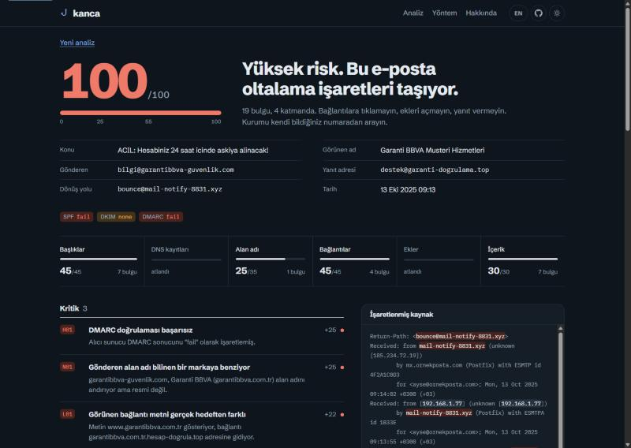

# Kanca

Paste a suspicious email, see exactly why it's phishing.

Kanca ("hook" in Turkish) reads the raw source of an email the way a security person would: who really sent it, which server it came through, where the links actually go, what the attachments are. Then it shows you the parts that give it away, highlighted right on the source, with a short note on why each one matters.

It runs entirely in your browser. The email you paste is not uploaded anywhere.

**Try it:** [kanca.kadirify.com](https://kanca.kadirify.com/)

[Türkçe](README.tr.md)



## Why

Most phishing advice boils down to "be careful". That doesn't help much when the email looks exactly like your bank. I wanted something that points at the actual line and says: this is the problem, and here's why.

There is no AI model in here. The score comes from 50 plain rules that anyone can read in [`packages/engine/src/rules`](packages/engine/src/rules). Same email in, same result out.

## What it checks

- **Headers:** SPF, DKIM and DMARC results, From vs Return-Path vs Reply-To, display name tricks, the Received chain.
- **Domain:** lookalikes of ~80 commonly impersonated brands (banks, couriers, big tech, government), brand names used as subdomains, punycode, cheap TLDs.
- **Links:** text that shows one address but goes to another, IP links, shorteners, `user@host` tricks, forms inside the email.
- **Attachments:** executables, double extensions, macro-enabled Office files, archives, HTML attachments. Nothing is opened.
- **Content:** urgency, threats, prize and refund bait, requests for passwords or card numbers, hidden text. Turkish and English for now.
- **DNS (optional):** MX, SPF and DMARC records of the sender domain. Only the domain name goes to the server.

Every rule has a weight, and each layer has a cap, so a pile of weak text signals can't push an email to "high risk" on its own. The full scoring is described on the method page of the site and in [docs/architecture.md](docs/architecture.md).

## Running it locally

You need Node 20+ and pnpm.

```bash
pnpm install
pnpm --filter @kanca/engine build
pnpm --filter @kanca/api dev   # localhost:3010, only needed for the DNS check
pnpm --filter @kanca/web dev   # localhost:5180
```

There's also a small CLI, handy for testing rules against a folder of emails:

```bash
pnpm analyze samples/paypal-en.eml
pnpm analyze samples/banka-oltalama.eml --lang tr
pnpm analyze some-mail.eml --dns --json
```

Tests:

```bash
pnpm test
```

## Project layout

```
packages/engine   parsing, rules and scoring. Works in the browser and in Node.
apps/web          the site (React + Vite)
apps/api          tiny Hono server with a single DNS lookup endpoint
api/              Vercel function wrapping apps/api
samples/          example emails used by the tests and the "try a sample" buttons
```

## Deploying

On Vercel, import the repo and keep the root directory as is. `vercel.json` already has the build command, output folder and the `/api` rewrite.

On your own server, `pnpm build` and then `node apps/api/dist/server.js` serves both the API and the built site on one port.

## Limits

Kanca doesn't open links, so it can't tell you where a shortened link ends up. It doesn't open attachments either, so it won't see what's inside a zip. It doesn't check domain age or blocklists, because those would mean sending data to third parties. A low score doesn't mean an email is safe.

## Contributing

If it missed an obvious phishing email, or flagged a legit one, please open an issue. A sample helps a lot; strip your own name and address before sharing. Adding a brand is one line in [`packages/engine/src/domain.ts`](packages/engine/src/domain.ts), and a new rule is usually a few lines plus a test.

## License

MIT
